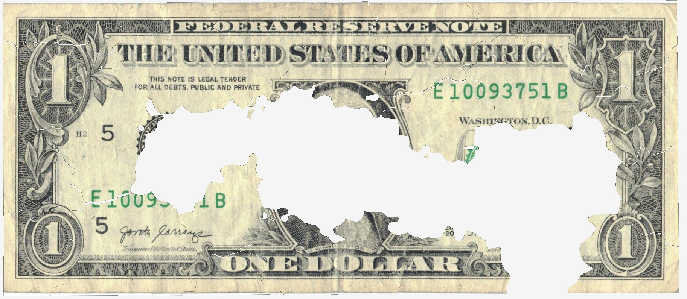
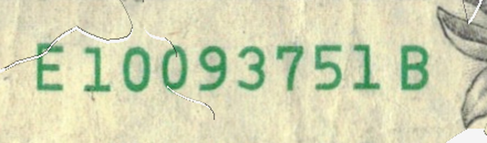
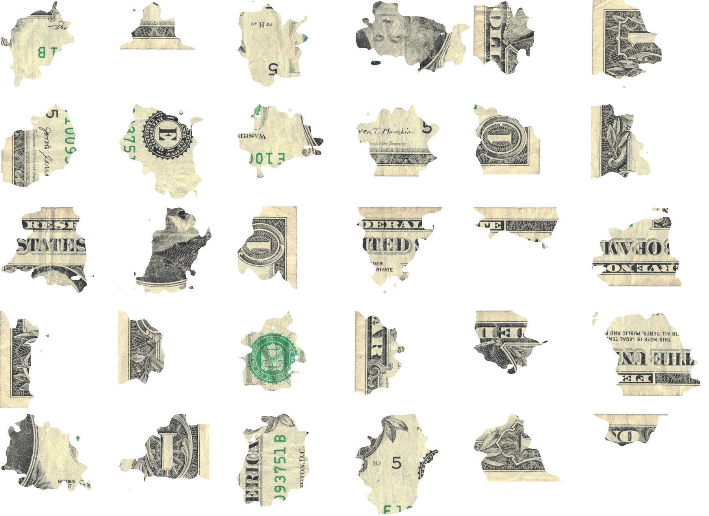
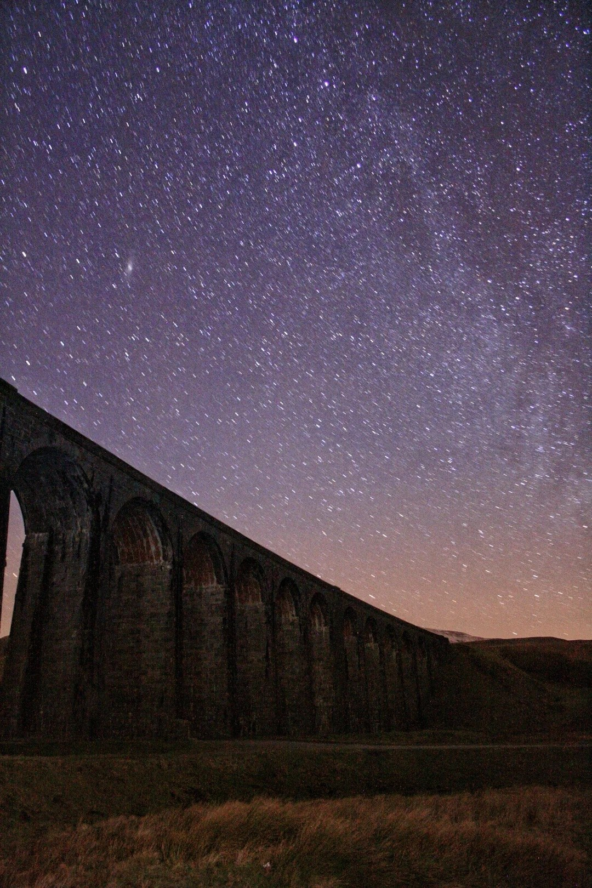
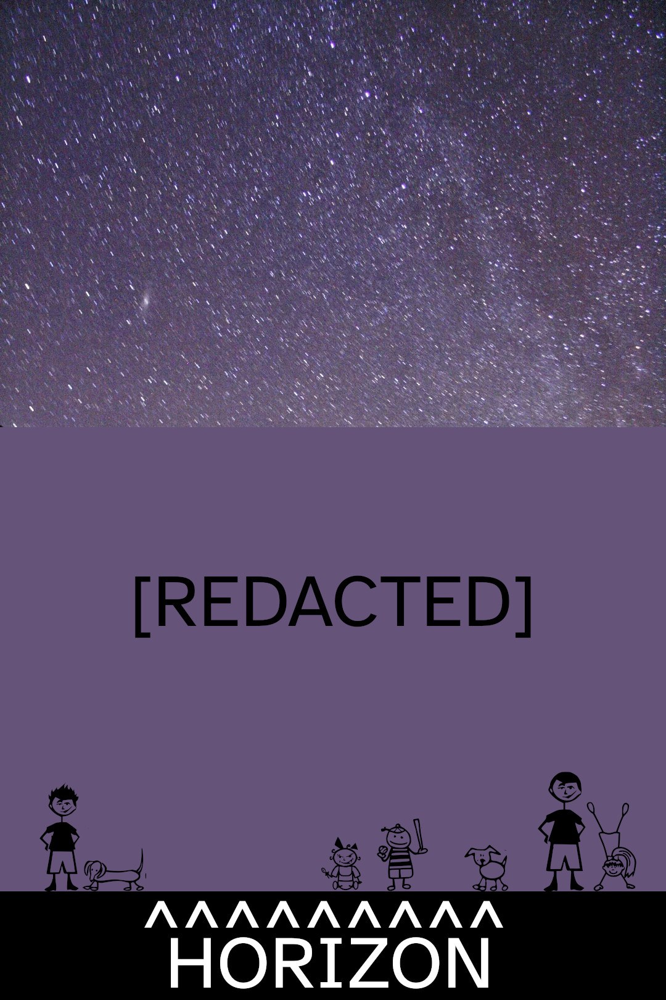
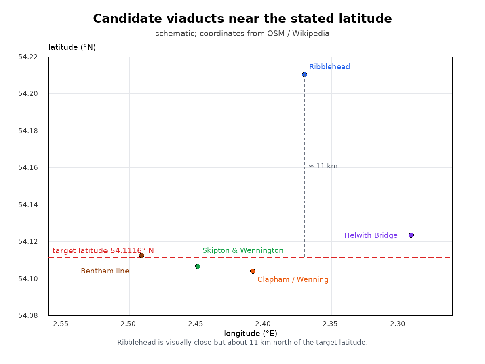
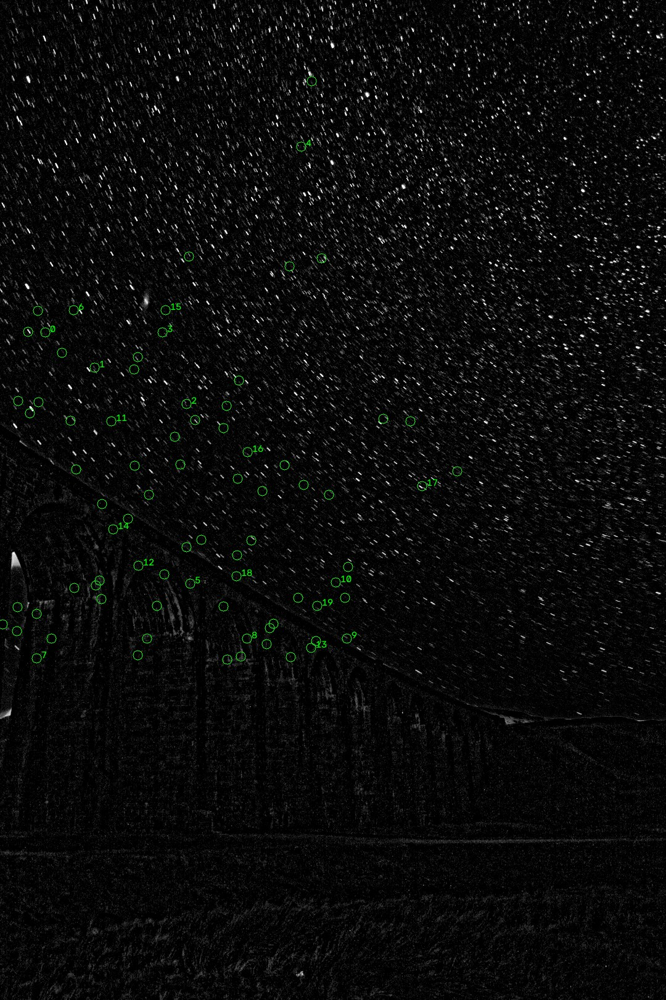
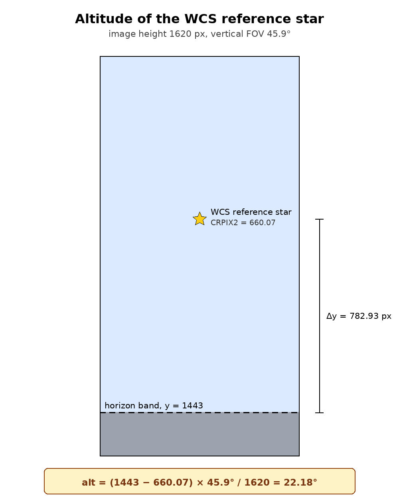
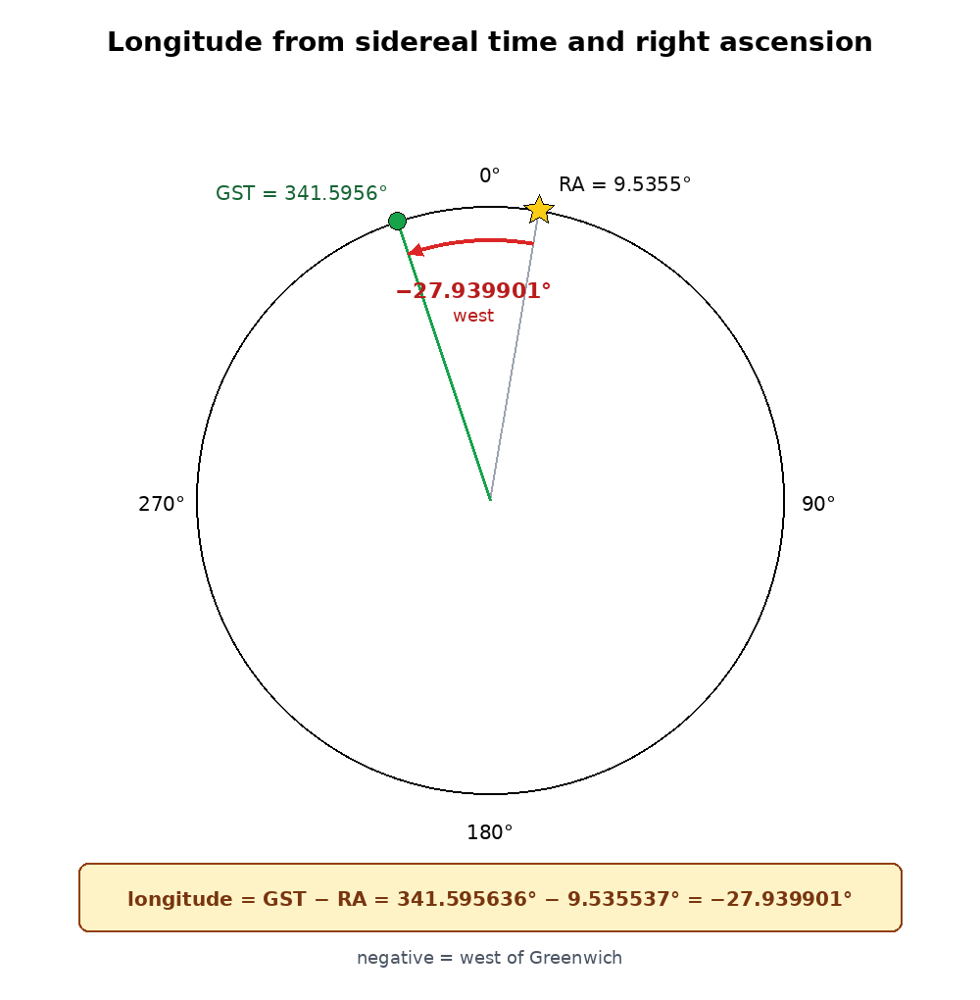

# Following the Money

| | |
|---|---|
| **Bagian** | wave 8 |
| **Kategori** | osint |
| **Jumlah Solve** | 35 |

## Ikhtisar

Uang kertas $1 yang dipindai dibagi menjadi tiga puluh sobekan. Merakit kembali teka-teki tersebut akan menghasilkan nomor seri, serial tersebut mengarah ke laporan Where's George, dan catatan laporan tersebut mengarah ke blog astrofotografi. Postingan blog tersebut berisi bidang bintang, stempel waktu pengambilan, bidang pandang kamera, dan gambar kedua yang cakrawalanya sengaja disunting.

Tantangannya adalah rantai OSINT, tetapi langkah terakhirnya adalah astrometri: selesaikan bidang bintang, ukur ketinggian bintang referensi WCS di atas cakrawala yang ditandai, dan gabungkan dengan waktu sidereal pada saat pengambilan gambar. Proses ini memakan waktu sekitar enam jam, sebagian besar dihabiskan di jembatan palsu dan pada perbedaan antara bintang di pusat gambar dan bintang di piksel referensi WCS.

## Penyelesaian

**Fragmennya.** Tiga puluh PNG adalah pecahan yang terkoyak dengan topeng alfa. Menyortirnya berdasarkan bentuk tepi dan mencocokkan garis yang terukir akan merekonstruksi uang kertas. Nomor seri dicetak dua kali, berwarna hijau, di kanan atas dan kiri bawah:



Close-up membuat karakter menjadi jelas:



Serialnya adalah `E10093751B`. Awalan `E` adalah surat distrik Federal Reserve untuk Richmond, `B` di belakangnya adalah surat cetak, dan tagihannya adalah seri $1 tahun 2017 dengan tanda tangan Jovita Carranza. Lembar kontak dari potongan asli berguna untuk memeriksa tumpang tindih:



**Di mana George.** Tantangannya memberikan `b:Fuzhs8rJ7u`. URL laporan langsungnya adalah

```text
https://www.wheresgeorge.com/report.php?b=Fuzhs8rJ7u
```

Catatan laporan menunjuk ke blog penulis:

```text
https://pointeroverflowctf.com/challenges/following-the-money/astroblog/
```

Riwayat perjalanan RUU tersebut berisi beberapa hit, tetapi catatan tersebut adalah satu-satunya bagian dari laporan yang digunakan dalam rantai tersebut.

**Blog.** Blog ini memiliki satu postingan relevan, #137, "Jembatan, akhirnya selesai". Judulnya memberikan waktu pengambilan:

```text
2024-10-12T21:18:38Z
```

Halaman tersebut menyatakan bahwa gambar tersebut memiliki tinggi 1620 piksel dan diambil dengan bidang pandang vertikal 45,9°. Ini juga mencakup dua gambar: bidang bintang, dan versi kedua dengan tanda cakrawala. Gambar kedua adalah lelucon: bagian bawah ditutupi oleh panel ungu `[REDACTED]`, deretan gambar kartun berada di atasnya, dan pita hitam berlabel `HORIZON` menandai cakrawala. Cakrawala tidak digambar sebagai sebuah garis; pita hitam adalah penandanya, pada baris piksel `y = 1443`.



**Perangkap jembatan.** Langkah yang jelas adalah mengidentifikasi jembatan tersebut. Garis lintang diberikan sebagai 54.1116 N, yang menunjuk pada perbatasan Yorkshire Dales / Lancashire / Cumbria. Kami membandingkan Ribblehead, Clapham/Wenning, jembatan Skipton & Wennington yang tidak disebutkan namanya, grup Jembatan Helwith, dan jalur Bentham. Ribblehead secara visual dekat tetapi terletak sekitar 11 km sebelah utara dari garis lintang yang disebutkan. Clapham memiliki garis lintang yang dekat tetapi memiliki lebih sedikit lengkungan dan kurva yang berbeda. Tak satu pun kandidat yang cocok dengan garis lintang dan perspektifnya. Jembatan itu adalah ikan haring merah: tantangannya tidak pernah menanyakan jembatan itu, ia menanyakan garis bujur kamera.



Log pencarian mencatat koordinat, kandidat yang ditolak, dan kueri yang gagal.

**Astrometri.** Bidang bintang adalah sensor sebenarnya. Astrometry.net memecahkan gambar dan mengembalikan WCS. Titik referensinya bukanlah bintang di pusat gambar; itu adalah bintang referensi WCS di `CRPIX`:

```text
CRVAL1 =   9.5355366203°   (RA)
CRVAL2 =  31.2660622861°   (Dec)
CRPIX1 =  63.2815876007
CRPIX2 = 660.067301432
```

Hamparan beranotasi menunjukkan bintang yang cocok:



**Ketinggian.** Baris piksel bintang referensi adalah `660.067301432`. Cakrawala berada pada baris `1443`. Dengan FOV vertikal 45,9° pada 1620 piksel, ketinggian bintang di atas cakrawala adalah

```text
alt = (1443 - 660.067301432) * 45.9 / 1620
    = 22.1831°
```



**Bujur.** Waktu pengambilan menunjukkan waktu sidereal Greenwich:

```text
GST = 280.46061837 + 360.98564736629 * (t - J2000) / 86400  (mod 360)
```

Di `2024-10-12T21:18:38Z`, `GST = 341.595636°`. Rumus garis bujur yang diisyaratkan adalah

```text
longitude = GST - RA
          = 341.595636 - 9.535537
          = 332.060099°  ->  -27.939901°
```



Pengiriman `-27.939901` diterima dan mengembalikan tanda tantangan:

```text
████████████████
```

**Apa yang tidak berhasil.** Cabang berbentuk bola penuh, yang menggunakan ketinggian dan garis lintang untuk memulihkan sudut jam, menghasilkan garis bujur yang berbeda dan ditolak. Bintang di pusat gambar juga menghasilkan garis bujur yang berbeda. Jalur yang diterima adalah `GST - RA` literal menggunakan bintang referensi WCS. Log pencarian memiliki detailnya.

**Reproduksi.** Pengukuran mentah ada di [`notes/measurements.md`](notes/measurements.md), log penelusuran lengkap ada di [`notes/search-log.md`](notes/search-log.md), dan penghitungan dapat direproduksi dengan [`scripts/solve_longitude.py`](scripts/solve_longitude.py). Diagram dibuat oleh [`scripts/make_diagrams.py`](scripts/make_diagrams.py). Kredit gambar ada di [`credits.md`](credits.md).

Garis bujurnya adalah -27.939901°.